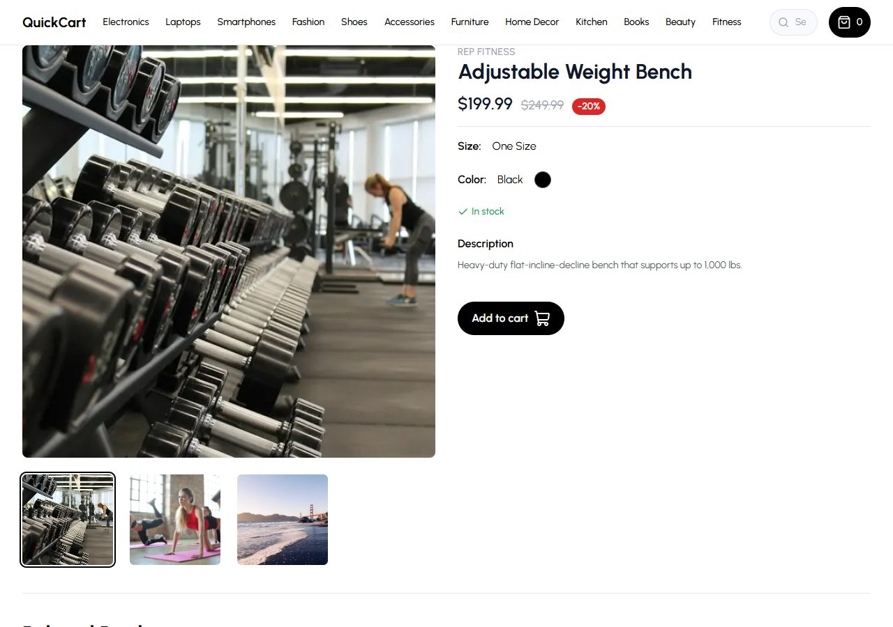
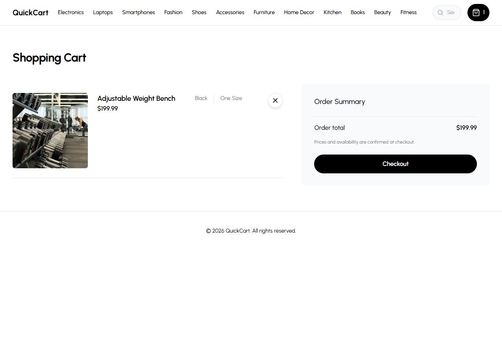

# QuickCart — Storefront

A customer-facing ecommerce storefront built with **Next.js 16 (App Router), React 19 and TypeScript**. Shoppers browse a catalog by category, search, filter by size, colour and price, preview products, keep a persistent cart, and pay through Stripe Checkout.

QuickCart is the **frontend half of a two-app system**. It has no database and no secrets of its own: all catalog data comes from the [EcommerceCloud](https://github.com/Shrasingh/EcommerceCloud) admin's public REST API, and checkout is a single `POST` to that API, which prices the cart server-side and returns a Stripe-hosted payment page.

**Live demo:** <https://quick-cart-eta-ecru.vercel.app> (seeded demo catalog; Stripe runs in **test mode**, use card `4242 4242 4242 4242`). The admin half is at <https://ecommerce-cloud-beta.vercel.app>.

---

## Contents

- [The problem it solves](#the-problem-it-solves)
- [Features](#features)
- [Screenshots](#screenshots)
- [Tech stack](#tech-stack)
- [Architecture](#architecture)
- [Core flows](#core-flows)
- [Data](#data)
- [Getting started](#getting-started)
- [Commands](#commands)
- [Testing strategy](#testing-strategy)
- [Deployment](#deployment)
- [Security considerations](#security-considerations)
- [Known limitations](#known-limitations)
- [Contributing and code quality](#contributing-and-code-quality)
- [Project origin](#project-origin)

---

## The problem it solves

A small seller manages products in a back office (EcommerceCloud) and needs a fast, public shop that stays in sync with that catalog without duplicating data or payment logic. QuickCart is that shop: it renders whatever the admin publishes, never stores prices or orders itself, and hands payment to Stripe. Any number of storefronts can point at the same admin by changing one environment variable.

## Features

All of the following are implemented and running on the live demo.

| Area | What it does |
|---|---|
| **Home** | Configurable hero billboard (`NEXT_PUBLIC_HOME_BILLBOARD_ID`, falls back to the store's first billboard) and featured products |
| **Browse** | Category pages from the navbar; `/products` shows the whole catalog |
| **Search** | Navbar search → `/products?q=…`; the admin matches name, brand, description and category, case-insensitively |
| **Filters** | Size, colour and price range, synced to the URL so results are shareable; mobile filter drawer |
| **Product page** | Image gallery, size/colour, discount badge, in/out-of-stock state, description, related products |
| **Quick preview** | Modal preview from any product card without leaving the grid |
| **Cart** | Persistent (localStorage) cart with live item count in the navbar; each product is a single unit |
| **Checkout** | One request to the admin creates the order and returns a Stripe Checkout URL; double-clicks are blocked, server error messages are shown to the user, cancellation returns to the cart |
| **Orders** | Order-received page after payment and a per-device `/orders` list. The storefront cannot see payment status (that is confirmed by the admin's Stripe webhook), so orders are shown as **Processing**, never falsely as paid. Reaching `/order-success` without a well-formed `orderId` shows a neutral page and leaves the cart untouched; revisiting it for an order this device already recorded (reload, Back, bookmark) leaves the cart untouched too |
| **Resilience** | Every API call has a 10 s timeout, a response-shape check and a safe fallback; a missing API URL is logged once with instructions instead of failing silently. An admin outage on a product or category page shows a retryable error page (`app/error.tsx`), not a false 404. Repeated or malformed query parameters (`?q=a&q=b`, `?minPrice=abc`) are normalised instead of crashing the page |
| **UX** | Skeleton loading state, empty states with recovery actions, 404 page, responsive layout, keyboard-operable product cards, labelled icon buttons, Open Graph metadata |

## Screenshots

Captured from a production build pointed at the live admin (seeded demo catalog), 2026-10-29.

| Home (desktop) | Product page |
|---|---|
|  |  |

| Cart with one item | Home (375 px wide) |
|---|---|
|  |  |

The admin dashboard (EcommerceCloud) is behind sign-in; its screenshots live in that repository.

## Tech stack

| Layer | Choice | Why |
|---|---|---|
| Framework | Next.js 16 App Router, React 19, TypeScript (strict) | Server components fetch catalog data per request; no client-side data fetching for the catalog |
| Styling | Tailwind CSS 3 | |
| UI primitives | Headless UI (dialog, tabs), lucide-react icons, framer-motion (order-received animation) | |
| Client state | zustand with `persist` middleware | Cart, guest orders and the preview modal; persisted stores are read only after hydration |
| HTTP | native `fetch` on the server (`lib/api.ts`), axios for the single browser `POST` | |
| Notifications | react-hot-toast | |
| Tests | Vitest 5 (node environment) | Fast, deterministic logic tests; no browser needed |
| Lint / types | ESLint 9 flat config with `eslint-config-next/core-web-vitals`, `tsc --noEmit` | |
| Hosting | Vercel | Git-connected; `main` → production |

## Architecture

```
┌──────────────────────────────┐                                     ┌──────────────────────────────┐
│  QuickCart (this repo)       │  GET /api/{storeId}/products?…      │  EcommerceCloud (admin)      │
│  Next.js 16 on Vercel        │  GET /categories, /sizes, /colors   │  Next.js 16 + Prisma         │
│                              │  GET /billboards[/id]               │  PostgreSQL · Clerk · Stripe │
│  Server components ──────────┼────────────────────────────────────▶│                              │
│   (actions/*.tsx → lib/api)  │                                     │  prices the cart, creates    │
│                              │  POST /api/{storeId}/checkout       │  Order(isPaid=false),        │
│  Browser (cart summary) ─────┼──── { productIds } ────────────────▶│  creates Stripe session      │
│                              │◀─── { url } ────────────────────────│                              │
└──────────────┬───────────────┘                                     └──────────────┬───────────────┘
               │ window.location.assign(url)                                        │ Stripe webhook
               ▼                                                                    ▼
        Stripe Checkout (hosted) ── success ──▶ /order-success?orderId=…     marks order paid,
                                 ── cancel ───▶ /cart?canceled=1             archives sold products
```

**Module layout**

```
app/
  layout.tsx                      Fonts, providers, navbar + footer, metadata; rendered per request
  (routes)/
    page.tsx                      Home: billboard + featured products
    products/page.tsx             Search results / full catalog with filters
    category/[categoryId]/        Category listing; components/filter.tsx + mobile-filters.tsx
    product/[productId]/page.tsx  Product detail + related products
    cart/                         Cart page, cart-item, components/summary.tsx (checkout)
    orders/page.tsx               Per-device guest order list
    order-success/                Order-received page (clears cart, records order id, once per id)
  loading.tsx · not-found.tsx     Skeleton and 404
  error.tsx · global-error.tsx    Retryable error boundaries (catalog unavailable)
actions/get-*.tsx                 One function per admin endpoint; thin wrappers over lib/api.ts
lib/
  api.ts                          getApiBaseUrl / fetchJson / apiGet / apiGetOne — timeout, shape guards, 404 vs outage
  search-params.ts                firstParam / priceParam — tolerate repeated and malformed query params
  cart.ts                         toCents / cartTotal — exact decimal arithmetic for the displayed total
  checkout.ts                     Error-message mapping and https-only redirect guard for checkout
  filters.ts                      Pure URL/query helpers behind the filter and search UI
hooks/
  use-cart.ts · use-orders.ts     zustand stores persisted to localStorage
  use-preview-model.ts            Preview modal state
  use-hydrated.ts                 useSyncExternalStore-based "are we past hydration" flag
components/                       navbar, search-bar, price-filter, product-card/list, gallery, modal, ui/*
type.ts                           Shared API response types
tests/                            Vitest suites for lib/* and hooks/use-cart
.github/workflows/ci.yml          Lint → typecheck → test → build on every push and PR to main
```

Design rules worth knowing:

- **Server components own data.** Pages `await` the `actions/*` functions and fetch independent resources with `Promise.all`, so page latency is the slowest request, not the sum.
- **Nothing on the client is trusted for money.** The cart sends product ids only; the admin re-reads prices from its database and converts them to integer cents before talking to Stripe. The total in the cart is for display.
- **Fail soft on lists, fail honestly on records.** A slow or down admin yields an empty list section after 10 s; a product or category page during an outage renders the error boundary with a retry button rather than claiming the item does not exist (`apiGetOne` returns `null` only for a 404). A missing `NEXT_PUBLIC_API_URL` logs a single clear error. Every JSON body is shape-checked before a component touches it.
- **Hydration-safe persisted state.** Anything read from `localStorage` renders only after `useHydrated()` is true, avoiding server/client markup mismatches without `setState`-in-effect.

## Core flows

**Browse / filter** — `components/price-filter.tsx` or `filter.tsx` computes the next query with `lib/filters.ts` → `router.push` → the page's `searchParams` change → `getProducts({...})` builds `?categoryId=&sizeId=&colorId=&minPrice=&maxPrice=&search=` → admin validates with zod and queries Prisma → cards re-render.

**Add to cart** — `ProductCard`/`Info` → `useCart().addItem(product)` → zustand persists the product to `localStorage["cart-storage"]` → navbar count updates. Adding the same product twice is rejected with a toast.

**Checkout** — `Summary.onCheckout` sets an in-flight flag (button disabled, "Redirecting…") → `POST {API}/checkout { productIds }` (base URL from `lib/api.ts`; if it is unset the button shows "Checkout is temporarily unavailable" instead of posting) with a 15 s timeout → on 2xx, the returned URL is accepted only if it is absolute `https:` and the browser navigates to Stripe → on 4xx the admin's customer-facing text is shown (e.g. an item sold out), on 5xx/network a generic message, and the button is re-enabled.

**After payment** — Stripe redirects to `/order-success?orderId=…`: if the id is well-formed (`parseOrderId` in `lib/checkout.ts`) and not yet recorded on this device, the cart is cleared, the id is stored in `localStorage["quickcart-orders"]`, and a 5-second countdown returns to the catalog; without a well-formed id the page says "No order to show" and changes nothing, and a revisit for an already recorded id leaves the cart alone (it may hold the next order). Payment confirmation itself happens admin-side via webhook; the storefront never claims an order is paid. Cancelling in Stripe returns to `/cart?canceled=1`, which shows a toast, leaves the cart intact and drops the flag from the URL so a reload does not repeat it.

## Data

QuickCart stores nothing server-side. The two browser-side stores are:

| Key | Shape | Purpose |
|---|---|---|
| `cart-storage` | `{ items: Product[] }` | The cart (full product snapshots, so the cart page renders without refetching) |
| `quickcart-orders` | `{ orders: { id, date }[] }` | Order ids placed from this device |

Response types for the admin API live in `type.ts`. The admin's schema, migrations and order model are documented in the EcommerceCloud repository.

## Getting started

### Prerequisites

- **Node.js 22 or newer** (`query-string@10` requires it; `package.json` declares `engines.node >= 22`; CI uses Node 22) and npm.
- A running **EcommerceCloud** admin with at least one store. Follow that repo's README; its seed script creates a demo catalog and prints the `storeId` you need below.

### 1. Install

```bash
git clone https://github.com/Shrasingh/QuickCart.git
cd QuickCart
npm install
```

### 2. Configure

```bash
cp .env.example .env
```

| Variable | Required | Example | Meaning |
|---|---|---|---|
| `NEXT_PUBLIC_API_URL` | **yes** | `http://localhost:3000/api/0f1e2d3c-…` | `<admin-origin>/api/<storeId>` — the store this shop sells |
| `NEXT_PUBLIC_SITE_URL` | no | `http://localhost:3001` | Public URL of this storefront, for Open Graph metadata. Must be absolute `http(s)`; anything else is ignored with a warning and the default is used |
| `NEXT_PUBLIC_HOME_BILLBOARD_ID` | no | `9a8b7c6d-…` | Hero billboard; defaults to the store's first billboard |

All three are `NEXT_PUBLIC_` and therefore visible in the browser by design; none is a secret. The Stripe keys live only in the admin.

### 3. Run

```bash
npm run dev -- -p 3001      # http://localhost:3001
```

Run the admin on port 3000 and the storefront on 3001, and set the admin's `FRONTEND_STORE_URL=http://localhost:3001` so Stripe redirects come back to the right place.

If the home page is empty, check the terminal: a missing or wrong `NEXT_PUBLIC_API_URL` is logged as `[api] …` with the fix.

### Troubleshooting

| Symptom | Likely cause | Fix |
|---|---|---|
| Empty catalog, `[api] request failed (TypeError)` in the terminal | Admin not running, or `NEXT_PUBLIC_API_URL` points at the wrong origin | Start the admin; copy the exact URL from its Settings page |
| Empty catalog, `[api] 404 from …` | Wrong `storeId` in `NEXT_PUBLIC_API_URL`, or a trailing path | Use `<admin-origin>/api/<storeId>` with nothing after the id |
| Checkout toast "Checkout is temporarily unavailable" | `NEXT_PUBLIC_API_URL` unset in the browser bundle, or the admin returned 503 (its Stripe/`FRONTEND_STORE_URL` config is missing) | Set the variable and rebuild; check the admin's logs for `[CHECKOUT_CONFIG]` |
| Checkout toast "Checkout failed" with no detail | Network error, timeout (15 s) or an admin 5xx | Check the admin's logs; details are deliberately not shown to shoppers |
| Stripe returns to the wrong site after paying | The admin's `FRONTEND_STORE_URL` points elsewhere | Set it to this storefront's URL in the admin's environment |
| `[site] NEXT_PUBLIC_SITE_URL is not an absolute http(s) URL` | Bare hostname or missing scheme | Use `https://…`; the app keeps working with the default meanwhile |

## Commands

| Command | What it does |
|---|---|
| `npm run dev` | Development server with hot reload |
| `npm run build` | Production build (`next build`) |
| `npm start` | Serve the production build |
| `npm run lint` | ESLint (`next/core-web-vitals`); currently 0 errors, 0 warnings |
| `npm run typecheck` | `tsc --noEmit` in strict mode |
| `npm test` | Vitest, single run (91 tests) |
| `npm run test:watch` | Vitest in watch mode |

All four checks run in CI on every push and pull request to `main`.

## Testing strategy

Tests are **logic-level** and run in a plain Node environment in under 5 seconds with no network, no browser and no backend:

| Suite | Covers |
|---|---|
| `tests/cart.test.ts` | `toCents` / `cartTotal`: exact decimal → cents, half-cent rounding, invalid prices |
| `tests/checkout.test.ts` | Checkout error mapping (4xx text surfaced, 5xx hidden, 503, network), the https-only redirect guard, the back-forward-cache listener and the `/order-success` order-id guard |
| `tests/api.test.ts` | `lib/api.ts`: base-URL handling, timeout signal, non-2xx / thrown / invalid-JSON / wrong-shape fallbacks, missing-env behaviour, `apiGetOne` (null only on 404, throws on outage) |
| `tests/search-params.test.ts` | Repeated (`string[]`) and malformed query parameters are normalised, not forwarded or thrown on |
| `tests/use-orders.test.ts` | Guest order store: records an id once, reports revisits, persists under `quickcart-orders` |
| `tests/get-products.test.ts` | Query-string construction and encoding for every filter, non-array bodies yield an empty list, with `fetch` mocked |
| `tests/filters.test.ts` | Price-range toggling, single-select filter toggling, search URL building |
| `tests/use-cart.test.ts` | Cart store: add, duplicate rejection, remove, clear (with an in-memory `localStorage`) |
| `tests/site-url.test.ts` | `NEXT_PUBLIC_SITE_URL` resolution: absolute URLs accepted, blank/malformed values fall back instead of failing the build |

Deliberately **not** covered: React component rendering and end-to-end browser flows. Those are validated manually on Vercel preview deployments (see `docs/DEPLOYMENT_WORKFLOW.md`); adding Playwright against a seeded admin is the natural next step.

### Testing checkout end to end (Stripe test mode)

The storefront has no Stripe code, so a full checkout needs the admin running with Stripe **test** keys. Never use a live key or a real card.

1. Run the admin (EcommerceCloud) on port 3000 with `STRIPE_API_KEY=sk_test_…`, `STRIPE_WEBHOOK_SECRET` and `FRONTEND_STORE_URL=http://localhost:3001`; run this storefront on 3001 pointing at that admin.
2. Forward webhooks to the admin: `stripe listen --forward-to localhost:3000/api/webhook` (the printed `whsec_…` is the webhook secret for that session).
3. Add a product, open the cart, click **Checkout**, pay with `4242 4242 4242 4242` (any future expiry, any CVC).
4. Expected: Stripe returns to `/order-success?orderId=…`, the cart is empty, `/orders` lists the id as **Processing**, and the admin dashboard shows the order as **paid** only after the `checkout.session.completed` webhook is delivered. Use **Back** or the Stripe cancel link instead of paying to confirm `/cart?canceled=1` keeps the cart.
5. Resend the same event from the Stripe CLI (`stripe events resend <evt_…>`) and confirm the order is not fulfilled twice (the admin's webhook only acts on the unpaid → paid transition).

## Deployment

The storefront is a standard Next.js app on **Vercel**, connected to this GitHub repository:

1. Import the repo in Vercel (already done for the live demo).
2. Set `NEXT_PUBLIC_API_URL` for the **Production** scope to the deployed admin's `https://…/api/<storeId>`, and `NEXT_PUBLIC_SITE_URL` to the storefront's own URL. Set a **Preview**-scope `NEXT_PUBLIC_API_URL` pointing at a *staging* store, or leave it unset, so pull-request previews cannot create orders in the production store.
3. Every push to `main` deploys to production; every pull request gets its own preview URL.
4. Make sure the admin's `FRONTEND_STORE_URL` points back at the production storefront.

The full workflow — environments, validation gates, branch protection steps, rollback — is in [`docs/DEPLOYMENT_WORKFLOW.md`](docs/DEPLOYMENT_WORKFLOW.md).

`next.config.mjs` allows product images from `res.cloudinary.com`, `images.unsplash.com`, `plus.unsplash.com` and `picsum.photos`; add other hosts there.

## Security considerations

- **No secrets in this app.** `.env` and `.vercel` are git-ignored; every variable is public by design.
- **Prices and totals are never trusted from the client.** Checkout sends ids; the admin prices from its database.
- **Redirect guard.** The browser follows the checkout URL only if it is an absolute `https:` URL (`lib/checkout.ts`).
- **No authentication, by design.** Guest checkout only; `/orders` is a per-device convenience and the `orderId` in the URL authorises nothing.
- **Error messages.** Only the admin's deliberate 4xx texts reach the user; 5xx bodies never do.
- **Security headers.** `next.config.mjs` sends `X-Content-Type-Options: nosniff`, `X-Frame-Options: DENY`, a `Referrer-Policy`, a restrictive `Permissions-Policy`, and a Content Security Policy in **report-only** mode (see `docs/DEPLOYMENT_WORKFLOW.md` for promoting it to enforcing). `X-Powered-By` is disabled.
- **Dependencies.** `npm audit` reports 0 vulnerabilities (production and dev) as of 2026-10-29.
- **What this is not:** a security-audited production shop. The browser calls the admin's `/checkout` endpoint directly, so rate limiting and bot protection for checkout **cannot** be implemented in this repository; they belong on the admin (an edge/WAF rule or a shared-store limiter in EcommerceCloud). The CSP is report-only until it has been verified on a preview deployment.

## Known limitations

- **Single unit per product.** The cart holds each product once because the admin archives a product when it sells (single-unit inventory). Quantities would need an admin change first.
- **Order status is not live.** The admin exposes no public order endpoint, so `/orders` can only say "Processing".
- **Cart prices are snapshots.** The cart stores the product as it was when added; if the admin changes a price afterwards, the cart shows the old figure until the item is re-added, while the admin charges the current price. The cart says so under the total. Re-pricing the cart on load would need a batch product endpoint on the admin.
- **Search is desktop-only** (hidden below the `md` breakpoint). The category nav scrolls sideways on narrow screens instead of wrapping; a mobile menu would be the next step.
- **Prices are USD** and formatted for `en-US`.
- **No end-to-end tests** yet; see Testing strategy.
- **Missing products and categories render the 404 page with HTTP status 200.** `app/(routes)/loading.tsx` wraps every route in a streaming boundary, so the shell (status 200) is already sent when `notFound()` runs; verified on 2026-10-29 that removing that file makes `/product/<unknown>` and `/category/<unknown>` answer 404. Users see the right page either way; only crawlers see a "soft 404". The fix is to move the skeleton out of the shared boundary (or drop it for the two record pages), which is a UX trade-off left open on purpose.
- **Preview checkout needs an allow-listed origin.** The admin only accepts checkout from, and redirects back to, browser origins it knows: its `FRONTEND_STORE_URL` plus any `ALLOWED_STOREFRONT_ORIGINS`. A Preview deployment on an unlisted origin gets a 403 ("Checkout failed" toast) rather than creating an order or being sent to production's `/order-success`. To test checkout on previews, use a fixed preview alias and list it in the admin's Preview environment (see `docs/DEPLOYMENT_WORKFLOW.md` §4).

## Contributing and code quality

- Branch from `main` (`feat/…`, `fix/…`, `docs/…`), open a pull request, and let CI run lint, typecheck, tests and the build. The PR template lists the manual checks.
- Keep business logic in `lib/*` as pure functions with tests; keep components thin.
- Commit as yourself: this repo's local git identity is set to the project author; see [`docs/GIT_WORKFLOW_AND_ATTRIBUTION.md`](docs/GIT_WORKFLOW_AND_ATTRIBUTION.md) for why that matters and how to avoid inheriting a different global identity in a fresh clone.
- Engineering docs: [`docs/ENGINEERING_AUDIT.md`](docs/ENGINEERING_AUDIT.md) (findings and evidence), [`docs/ENGINEERING_REVIEW.md`](docs/ENGINEERING_REVIEW.md) (what changed and why), [`docs/DEPLOYMENT_WORKFLOW.md`](docs/DEPLOYMENT_WORKFLOW.md).

## Project origin

QuickCart is a personal portfolio project by **Shraddha Singh** ([@Shrasingh](https://github.com/Shrasingh)), built to learn and demonstrate a Next.js App Router storefront that consumes a separate admin API. It is not affiliated with or endorsed by any company.

The initial Create-Next-App scaffold and the first versions of the gallery, cart store and order summary were committed by **Shivang Tripathi** ([@shivang-tripati](https://github.com/shivang-tripati)) in May–June 2024. Everything since — category and mobile filters, search, price filtering, guest orders and the order-received flow, the configurable billboard, the Next.js 16 / React 19 upgrade, the shared API client, checkout hardening, accessibility work, the test suite, CI and these docs — is in the git history under the project author's name.

AI coding tools were used for parts of the refactoring, tests and documentation. Every change was reviewed and is explained in `docs/ENGINEERING_REVIEW.md`.

## License

Personal portfolio project; no license granted for reuse.
